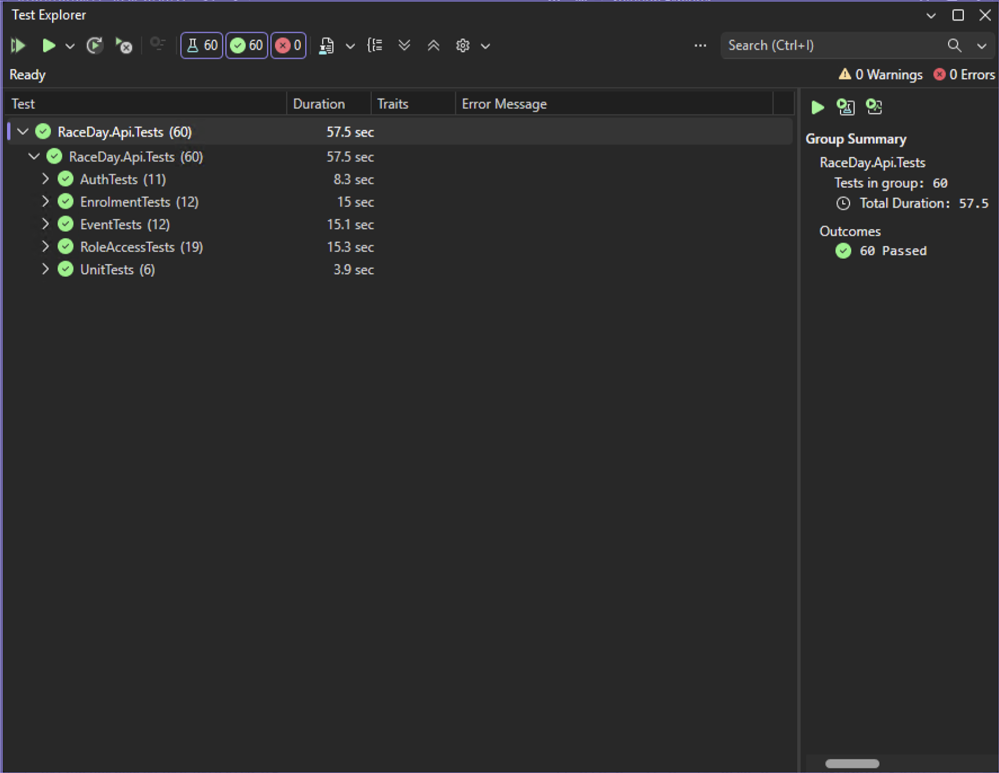
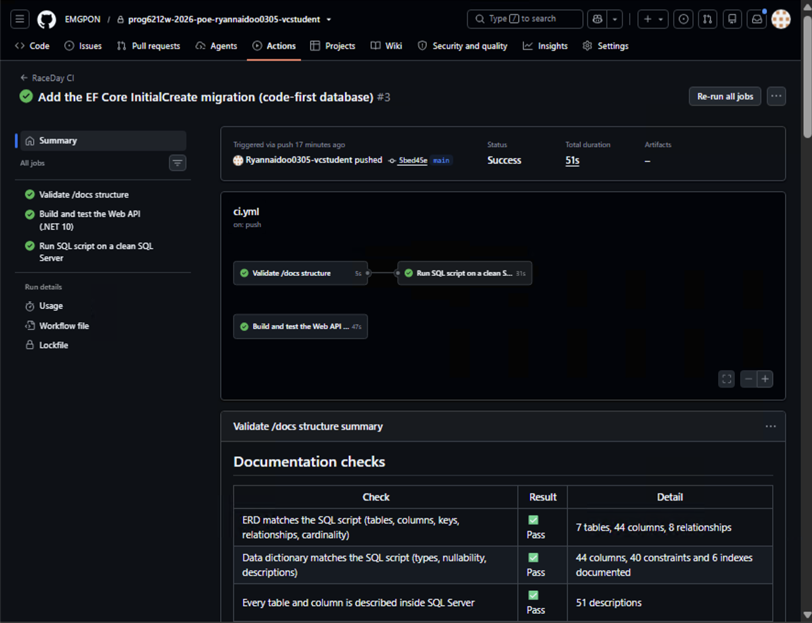

# RaceDay

**Event management for South Africa's road running, walking and cycling community**

| | |
|---|---|
| **Module** | PROG6212 - Programming 2B (POE) |
| **Student** | Ryan Naidoo - ST10487315 |
| **Current part** | Part 2 - ASP.NET Core Web API, in the [`Part2`](Part2) folder |
| **Part 2 video** | https://youtu.be/lnFt0aqHebA |
| **Part 1 video** | https://youtu.be/viBa_j2k-k4 |

## Overview

RaceDay is a REST API for community races, walks and cycle tours. Organisers create events, add age or distance categories, confirm entries and publish results. Participants browse events, enter in a category and see their results. Part 2 is an ASP.NET Core Web API (.NET 10) with EF Core code-first on SQL Server, session-based login with two roles, Swagger and xUnit tests.

| Part | Deliverable |
|---|---|
| 1 | ERD, API endpoint plan and SQL Server script (in [`/docs`](docs)) |
| 2 | ASP.NET Core Web API with EF Core, sessions, Swagger and unit tests *(this submission)* |
| 3 | ASP.NET Core MVC front end, Azure Blob Storage and Docker |

## Roles

| Role | What they can do |
|---|---|
| **Organiser** | Create, edit and delete **their own** events; add, edit and remove categories; view and confirm entries for their events; capture, correct and publish results; see a dashboard of their events. |
| **Participant** | Register and update their profile; browse events; enter an event in a category (age checked on race day); see and withdraw their entries; see their published results, e.g. *1st of 5 finishers*. |

The role is chosen at registration and can't be changed through the API. After login the API stores the user's **UserId** and **Role** in a server-side session; the browser only gets an HttpOnly session cookie. Every protected endpoint has the `[RequireSession]` filter: no session gives **401**, the wrong role gives **403**, and an Organiser changing someone else's event also gets **403**. Passwords are stored as BCrypt hashes.

## Setup and run

You need Visual Studio 2026 with the *ASP.NET and web development* workload (it includes the .NET 10 SDK and SQL Server LocalDB).

1. **Clone** the repository:
   ```bash
   git clone https://github.com/EMGPON/prog6212w-2026-poe-ryannaidoo0305-vcstudent.git
   ```
2. **Open** `Part2/RaceDay.sln` in Visual Studio.
3. **Connection string:** it is `ConnectionStrings:RaceDayDb` in [`Part2/RaceDay.Api/appsettings.json`](Part2/RaceDay.Api/appsettings.json). By default it uses `(localdb)\MSSQLLocalDB` and the database `RaceDayApiDB`. Change it if you use another SQL Server.
4. **Create the database:** open **Tools > NuGet Package Manager > Package Manager Console** and run `Update-Database`. (The API also applies the migration when it starts.) This creates the 7 tables with the Part 1 constraint names and seed data.
5. **Run the API:** press **F5**. Swagger opens at `https://localhost:7212/swagger` (or `http://localhost:5212/swagger`).
6. **Try it in Swagger:** `POST /api/auth/login` with `{ "email": "thandi.mokoena@example.com", "password": "RaceDay@2026" }`, then call any endpoint. Swagger keeps the session cookie.
7. **Run the tests:** **Test > Run All Tests** in Visual Studio, or `dotnet test Part2/RaceDay.sln`.

**Demo accounts** (password `RaceDay@2026` for all):

| Name | Email | Role |
|---|---|---|
| Thandi Mokoena | thandi.mokoena@example.com | Organiser (events 1 and 4) |
| Pieter van der Merwe | pieter.vdmerwe@example.com | Organiser (events 2 and 3) |
| Sipho Ndlovu | sipho.ndlovu@example.com | Participant |
| Aisha Patel | aisha.patel@example.com | Participant |

## API endpoints

The 26 Part 2 endpoints from [`docs/API_Endpoint_Plan.md`](docs/API_Endpoint_Plan.md), numbered as in the plan. #6 and #14 (image uploads) are built in Part 3 with Azure Blob Storage, as the plan says.

| # | Method | Route | Role |
|---|---|---|---|
| 1 | POST | `/api/auth/register` | None |
| 2 | POST | `/api/auth/login` | None |
| 3 | POST | `/api/auth/logout` | Any |
| 4 | GET | `/api/users/me` | Any |
| 5 | PUT | `/api/users/me` | Any |
| 7 | GET | `/api/event-types` | Any |
| 8 | GET | `/api/events` | Any |
| 9 | GET | `/api/events/{id}` | Any |
| 10 | GET | `/api/events/mine` | Organiser |
| 11 | POST | `/api/events` | Organiser |
| 12 | PUT | `/api/events/{id}` | Organiser (owner) |
| 13 | DELETE | `/api/events/{id}` | Organiser (owner) |
| 15 | GET | `/api/events/{eventId}/categories` | Any |
| 16 | POST | `/api/events/{eventId}/categories` | Organiser (owner) |
| 17 | PUT | `/api/categories/{id}` | Organiser (owner) |
| 18 | DELETE | `/api/categories/{id}` | Organiser (owner) |
| 19 | POST | `/api/events/{eventId}/enrolments` | Participant |
| 20 | GET | `/api/enrolments/mine` | Participant |
| 21 | PUT | `/api/enrolments/{id}/cancel` | Participant (own) |
| 22 | GET | `/api/events/{eventId}/enrolments` | Organiser (owner) |
| 23 | PUT | `/api/enrolments/{id}/status` | Organiser (owner) |
| 24 | POST | `/api/events/{eventId}/results` | Organiser (owner) |
| 25 | PUT | `/api/results/{id}` | Organiser (owner) |
| 26 | PUT | `/api/events/{eventId}/results/publish` | Organiser (owner) |
| 27 | GET | `/api/events/{eventId}/results` | Organiser (owner) |
| 28 | GET | `/api/results/mine` | Participant |

The success and failure codes for each endpoint are in the endpoint plan and in Swagger.

**Changes from the Part 1 plan:** the `UNIQUE` constraints are created by EF Core as unique indexes with the same names (EF Core maps unique rules to indexes); the database is called `RaceDayApiDB` so it doesn't overwrite Part 1's `RaceDayDB`; #17 also refuses an entry limit below the entries already made; #23 keeps an entry Confirmed once it has a result.

## Unit testing

The tests are in [`Part2/RaceDay.Api.Tests`](Part2/RaceDay.Api.Tests) and use xUnit. Most tests start the real API in memory with `WebApplicationFactory` and send real HTTP requests, using an EF Core in-memory database with the Part 1 seed data, so the sessions, role checks and validation are tested exactly as they run.

| Area | Test class | Examples |
|---|---|---|
| Registration and login | `AuthTests` | 201 for a new Participant; 409 for a duplicate email; 400 for weak passwords and an unknown role; 401 for a wrong password; logout ends the session |
| Role rejection | `RoleAccessTests` | Protected endpoints give 401 without a session; 403 for the wrong role; 403 for another Organiser's event |
| Event management | `EventTests` | Create, update and delete; 400 for a past date, zero distance or unknown type; 409 when deleting an event with entries; category rules |
| Enrolments and results | `EnrolmentTests` | 201 Pending; 409 for entering twice; 400 for the wrong age category, another event's category or a past event; withdraw and confirm; results and positions |
| Business rules | `UnitTests` | BCrypt hashing and the Part 1 seed hash; age on race day |

Screenshot of the tests passing in Visual Studio Test Explorer:



## CI/CD

The GitHub Actions workflow in [`.github/workflows/ci.yml`](.github/workflows/ci.yml) runs on Linux on every push:

1. **Validate /docs structure** (Part 1) - the planning documents exist and agree with each other.
2. **Run SQL script on a clean SQL Server** (Part 1) - runs the Part 1 script and constraint tests.
3. **Build and test the Web API (.NET 10)** (Part 2) - restores, builds and runs all the xUnit tests, and writes the result to the run's Summary.



## Video

**Part 2** (unlisted YouTube, in my own voice): **https://youtu.be/lnFt0aqHebA**

It goes through the rubric, shows every endpoint working in Swagger, explains the core logic, runs the tests and shows the CI build.

**Part 1:** https://youtu.be/viBa_j2k-k4

## AI usage disclosure

As the PoE instructions require, I disclose that I used Claude (Anthropic, 2026), an AI assistant, in both parts:

- **Claude wrote the Part 2 code**: the entities, EF Core configurations, seed data, controllers, session filter, DTOs, the xUnit tests, the CI job and this README.
- **What I did:** added the code to the `Part2` folder in feature-sized commits; generated the EF Core migration myself in Visual Studio (`Add-Migration InitialCreate`) and created the database with `Update-Database`; checked the database in SSMS; built the solution and ran the tests; and tested every endpoint in Swagger. The video is my own explanation of how the code works.

## Reference list

Anthropic. 2026. *Claude (Opus 5.5)* [Large language model]. [Online]. Available at: https://claude.ai [Accessed 26 October 2026].

BcryptNet. n.d. *bcrypt.net: BCrypt.Net-Next*. [Online]. Available at: https://github.com/BcryptNet/bcrypt.net [Accessed 26 October 2026].

GitHub. n.d. *GitHub Actions documentation*. [Online]. Available at: https://docs.github.com/en/actions [Accessed 26 October 2026].

Microsoft. n.d.a. *Session and state management in ASP.NET Core*. [Online]. Available at: https://learn.microsoft.com/en-us/aspnet/core/fundamentals/app-state [Accessed 26 October 2026].

Microsoft. n.d.b. *Integration tests in ASP.NET Core*. [Online]. Available at: https://learn.microsoft.com/en-us/aspnet/core/test/integration-tests [Accessed 26 October 2026].

Microsoft. n.d.c. *Migrations overview*. [Online]. Available at: https://learn.microsoft.com/en-us/ef/core/managing-schemas/migrations/ [Accessed 26 October 2026].

Microsoft. n.d.d. *Data seeding*. [Online]. Available at: https://learn.microsoft.com/en-us/ef/core/modeling/data-seeding [Accessed 26 October 2026].

Microsoft. n.d.e. *Filters in ASP.NET Core*. [Online]. Available at: https://learn.microsoft.com/en-us/aspnet/core/mvc/controllers/filters [Accessed 26 October 2026].

xUnit.net. n.d. *xUnit.net*. [Online]. Available at: https://xunit.net/ [Accessed 26 October 2026].
