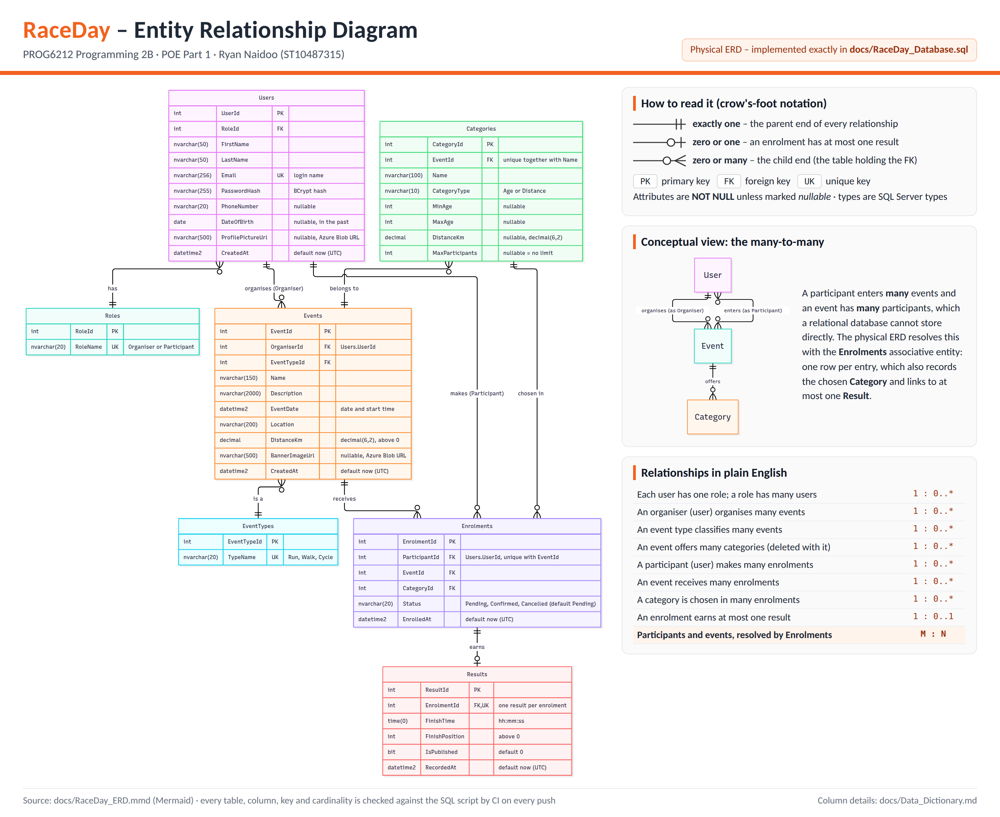
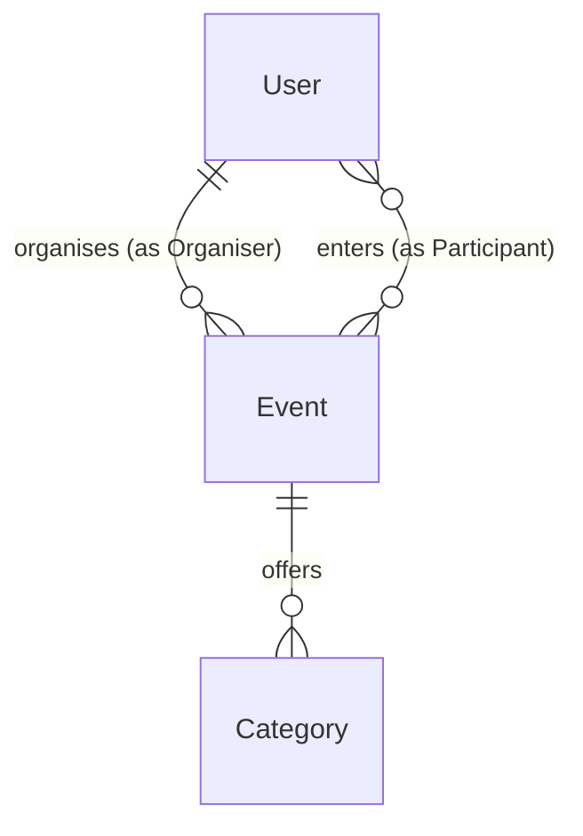
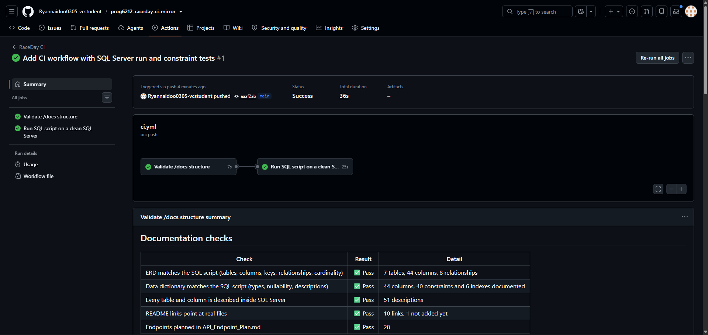

# RaceDay

**Event management for South Africa's road running, walking and cycling community**


| | |
|---|---|
| **Module** | PROG6212 - Programming 2B (POE) |
| **Student** | Ryan Naidoo - ST10487315 |
| **Current part** | Part 1 - System Planning and Database |
| **Video** | https://youtu.be/viBa_j2k-k4 |

## Contents

1. [About RaceDay](#about-raceday)
2. [User roles](#user-roles)
3. [Marker's guide](#markers-guide)
4. [Part 1 deliverables](#part-1-deliverables)
5. [Quick start](#quick-start)
6. [Database design](#database-design)
7. [Seed data and demo accounts](#seed-data-and-demo-accounts)
8. [Testing and CI/CD](#testing-and-cicd)
9. [Video presentation](#video-presentation)
10. [Repository structure](#repository-structure)
11. [AI usage disclosure](#ai-usage-disclosure)
12. [Reference list](#reference-list)

## About RaceDay

Most community races, park runs, charity walks and cycle tours in South Africa are still run on paper entry forms, spreadsheets and WhatsApp groups. RaceDay brings it all into one web platform: **Organisers** create events, set up age or distance categories, manage entries and publish results, while **Participants** browse upcoming events, enter in the category that suits them and track their race history.

| Part | Deliverable |
|---|---|
| 1 | Planning: ERD, API endpoint plan and SQL Server database script *(this submission)* |
| 2 | ASP.NET Core Web API with EF Core, session-based role access, Swagger and unit tests |
| 3 | ASP.NET Core MVC front end, Azure Blob Storage image uploads and Docker |

## User roles

| Role | What they can do |
|---|---|
| **Organiser** | Create, edit and delete their **own** events; add age or distance categories; view and confirm the enrolments for their events; capture and publish finish times and positions; see a dashboard of their events and entries. |
| **Participant** | Register and manage their profile; browse and filter upcoming events; enter an event by choosing a category; see their enrolments and each one's status; view their own results (e.g. *47th of 312 finishers*). |

The role is chosen once, at registration, and cannot be changed through the API - so a Participant can never make themselves an Organiser.

## Marker's guide

Where to find the evidence for each Part 1 rubric criterion.

| Criterion (marks) | Evidence |
|---|---|
| **Correct submission** (5) | This README: system description, roles, setup notes, CI screenshot and video link. Every planning document is in [`/docs`](docs). |
| **ERD** (25) | [`RaceDay_ERD.png`](docs/RaceDay_ERD.png) / [`.pdf`](docs/RaceDay_ERD.pdf): 7 entities, every attribute with its type, PK/FK/UK, crow's-foot cardinality, and a conceptual view of the many-to-many that Enrolments resolves. [`Data_Dictionary.md`](docs/Data_Dictionary.md) documents every column. CI proves the ERD matches the SQL script exactly. |
| **API endpoint plan** (25) | [`API_Endpoint_Plan.md`](docs/API_Endpoint_Plan.md): 28 endpoints with all six columns and success **and** failure codes, plus a session sequence diagram, role access matrix, request field rules, JSON examples, user journeys, the enrolment status lifecycle and endpoint-to-table traceability. |
| **SQL database script** (20) | [`RaceDay_Database.sql`](docs/RaceDay_Database.sql): runs cleanly on a fresh instance (proven in CI, twice), 7 tables that match the ERD, 40 named constraints, 6 indexes, descriptions stored in SQL Server and realistic South African seed data for every table. [`RaceDay_Constraint_Tests.sql`](docs/RaceDay_Constraint_Tests.sql) proves the constraints work with 34 automated tests. |
| **GitHub and CI/CD** (15) | 20+ commits that build the work up step by step. [`ci.yml`](.github/workflows/ci.yml) validates `/docs`, cross-checks the ERD, data dictionary and SQL, runs the script on SQL Server 2022, checks the seed data and runs the constraint tests. See the green build [below](#testing-and-cicd). |
| **Referencing** (up to -10%) | Harvard Anglia throughout: in-text citations and an alphabetical reference list in this README and in the endpoint plan. |
| **Video** (10) | The link above, with chapters listed [below](#video-presentation): ERD decisions, endpoint plan choices, SQL design, the script run live in SSMS, and the constraint tests. |

## Part 1 deliverables

| File | What it contains |
|---|---|
| [`docs/RaceDay_ERD.png`](docs/RaceDay_ERD.png) and [`.pdf`](docs/RaceDay_ERD.pdf) | The ERD with a notation legend, a conceptual many-to-many view and every relationship in plain English |
| [`docs/RaceDay_ERD.mmd`](docs/RaceDay_ERD.mmd) | Mermaid source of the ERD (Mermaid, n.d.); CI compares it with the SQL script |
| [`docs/Data_Dictionary.md`](docs/Data_Dictionary.md) | Every table, column, relationship, index and named constraint, with delete rules and the rules the API enforces |
| [`docs/API_Endpoint_Plan.md`](docs/API_Endpoint_Plan.md) | 28 planned endpoints: HTTP method, route, description, role required, request body and expected responses |
| [`docs/RaceDay_Database.sql`](docs/RaceDay_Database.sql) | SQL Server script: tables, constraints, indexes, stored descriptions and seed data |
| [`docs/RaceDay_Constraint_Tests.sql`](docs/RaceDay_Constraint_Tests.sql) | 34 automated tests that try to break the database rules |



## Quick start

1. Open **SQL Server Management Studio (SSMS)** and connect to your local SQL Server (e.g. `localhost` or `.\SQLEXPRESS`).
2. Open `docs/RaceDay_Database.sql` and press **F5**. The Messages tab shows `STEP 1 complete` through `STEP 13 complete`. The result grids show row counts, previews of the Organiser dashboard and a Participant's results, and the data dictionary read straight from SQL Server.
3. Open `docs/RaceDay_Constraint_Tests.sql` and press **F5**. The Messages tab ends with `Constraint tests: 34 of 34 passed.`

> The database script drops and recreates `RaceDayDB`, so it can be run again at any time. The tests roll back every change, so they can be run as often as you like.

## Database design

**Seven entities:** Roles, Users, EventTypes, Events, Categories, Enrolments and Results. Full details are in the [data dictionary](docs/Data_Dictionary.md).

The conceptual model has one many-to-many relationship. Participants enter many events, and an event has many participants:



The physical design resolves it with the **Enrolments** associative table. Enrolments records the participant, the event **and** the chosen category, as the brief requires.

- **One Users table for both roles.** Organisers and Participants share the same login and profile fields, so a `RoleId` foreign key to a small **Roles** table identifies the role, and a CHECK constraint allows only *Organiser* and *Participant*.
- **Event types are a lookup table** (Run, Walk, Cycle) instead of free text, so filters stay consistent and new types can be added without changing the schema.
- **Every event belongs to one Organiser** (`Events.OrganiserId`), which lets the API make sure organisers only manage their own events.
- **Categories belong to one event** and are either *Age* (minimum/maximum age) or *Distance* (km). CHECK constraints block impossible data, such as a minimum age above the maximum.
- **Enrolments** stop double entries with `UNIQUE (ParticipantId, EventId)`. `Status` defaults to *Pending*, with a CHECK for Pending, Confirmed or Cancelled.
- **Enrolments to Results is one-to-zero-or-one.** A result can only exist for an entry, and never twice (`UNIQUE` on `Results.EnrolmentId`). "Position out of N finishers" is calculated rather than stored, so it cannot go out of date.
- **Deletes are safe by default.** Only Categories (with their event) and Results (with their enrolment) cascade. Everything else is `ON DELETE NO ACTION`, so an event with entries can't be deleted by accident. This also avoids SQL Server's "multiple cascade paths" error.
- **Images are stored as URLs** (`ProfilePictureUrl`, `BannerImageUrl`), ready for Azure Blob Storage in Part 3. **Passwords are stored only as BCrypt hashes**, and a date of birth must be in the past.
- **Every constraint is named** (`PK_`, `FK_`, `UQ_`, `CK_`, `DF_`), using SQL Server's `CREATE TABLE` syntax (Microsoft, n.d.a) and key constraints (Microsoft, n.d.b). Every table and column carries a description stored inside SQL Server as an extended property (Microsoft, n.d.d), so SSMS shows it too. EF Core's `HasComment()` keeps those descriptions in Part 2.
- **The SQL script matches the ERD exactly - there are no deliberate differences.** CI checks this on every push.

## Seed data and demo accounts

4 events (1 finished with published results, plus an upcoming run, walk and cycle), 13 categories, 10 enrolments (Confirmed, Pending and Cancelled) and 5 results.

| Name | Email | Role |
|---|---|---|
| Thandi Mokoena | thandi.mokoena@example.com | Organiser |
| Pieter van der Merwe | pieter.vdmerwe@example.com | Organiser |
| Sipho Ndlovu | sipho.ndlovu@example.com | Participant |
| Aisha Patel | aisha.patel@example.com | Participant |
| Lerato Dlamini | lerato.dlamini@example.com | Participant |
| Johan Botha | johan.botha@example.com | Participant |
| Kabelo Molefe | kabelo.molefe@example.com | Participant |

Demo password for every account: `RaceDay@2026` - the database stores only its BCrypt hash.

## Testing and CI/CD

**Constraint tests.** `RaceDay_Constraint_Tests.sql` runs 34 tests:

- 29 try to break a rule, such as a duplicate email, a third role, entering an event twice, a finish time of zero or deleting an event that has entries. Each passes only if SQL Server rejects it **with the expected constraint named in the error**.
- 5 check that rules which should allow something do, such as the Pending default and the two cascades.

Every test runs inside a transaction that is rolled back, using `TRY...CATCH` (Microsoft, n.d.e), so the seed data never changes.

**The CI/CD pipeline.** The GitHub Actions workflow (GitHub, n.d.) in `.github/workflows/ci.yml` runs on every push:

1. **Validate /docs structure.** Checks that every Part 1 file exists, that the plan has all six required columns and every resource, and that this README covers the roles, CI/CD and video. It then runs `.github/scripts/check_docs_consistency.py`, which fails the build if the ERD, the data dictionary and the SQL script disagree on any table, column, type, key, relationship, cardinality, constraint or description.
2. **Run SQL script on a clean SQL Server.** Starts a brand-new SQL Server 2022 container (Microsoft, n.d.c) and runs the script **twice**, proving it can be re-run. It checks the seed data meets the brief: at least 2 Organisers, 2 Participants and 3 Events, categories for every event, no plain-text passwords, no results for unconfirmed entries, and every description stored. Finally it runs all 34 constraint tests.

Both jobs publish their results as tables on the run's **Summary** page.

> **Note:** On 28 Sep 2026 GitHub would not start Actions jobs in the EMGPON classroom organisation because of an organisation billing limit. The screenshot below shows the same workflow passing on a private copy of this repository under my own GitHub account, and my lecturer has been notified.



## Video presentation

Part 1 walkthrough (unlisted YouTube): **https://youtu.be/viBa_j2k-k4**

| Time | Chapter |
|---|---|
| 0:00 | Introduction and repository tour |
| 1:50 | ERD: entities, keys, cardinality and the many-to-many |
| 3:40 | API endpoint plan: roles, sessions and failure codes |
| 6:40 | SQL script run live in SSMS |
| 7:30 | Constraint tests |
| 8:20 | CI/CD pipeline |

## Repository structure

```text
.
├── .github/
│   ├── scripts/check_docs_consistency.py   CI check: ERD, data dictionary and SQL agree
│   └── workflows/ci.yml                     CI pipeline
├── docs/
│   ├── API_Endpoint_Plan.md
│   ├── Data_Dictionary.md
│   ├── RaceDay_Constraint_Tests.sql
│   ├── RaceDay_Database.sql
│   ├── RaceDay_ERD.mmd
│   ├── RaceDay_ERD.pdf
│   ├── RaceDay_ERD.png
│   └── screenshots/part1-ci-green.png
└── README.md
```

## AI usage disclosure

<!-- Edit this so it is 100% accurate about how YOU used AI before you submit. -->
As required by the PoE instructions, I disclose that I used Claude (Anthropic, 2026), an AI assistant, while planning Part 1. It helped me review my entities and relationships and produced first drafts of:

- the SQL script and the constraint tests;
- the ERD source and image, and the data dictionary;
- the endpoint plan and its diagrams;
- the CI workflow and the consistency-check script;
- the structure of this README.

I added these files to this repository in stages rather than all at once: I built the SQL script one step at a time, running each step in SSMS before committing it, and added the endpoint plan section by section. I checked every step myself in SSMS and on GitHub, and I can explain every table, constraint, endpoint and CI check - see the video.

## Reference list

Harvard Anglia style. Pages with no visible publication date are cited as n.d. (no date).

Anthropic. 2026. *Claude (Opus 5.5)* [Large language model]. [Online]. Available at: https://claude.ai [Accessed 28 September 2026].

GitHub. n.d. *GitHub Actions documentation*. [Online]. Available at: https://docs.github.com/en/actions [Accessed 28 September 2026].

Mermaid. n.d. *Entity relationship diagrams*. [Online]. Available at: https://mermaid.js.org/syntax/entityRelationshipDiagram.html [Accessed 28 September 2026].

Microsoft. n.d.a. *CREATE TABLE (Transact-SQL)*. [Online]. Available at: https://learn.microsoft.com/en-us/sql/t-sql/statements/create-table-transact-sql [Accessed 28 September 2026].

Microsoft. n.d.b. *Primary and foreign key constraints*. [Online]. Available at: https://learn.microsoft.com/en-us/sql/relational-databases/tables/primary-and-foreign-key-constraints [Accessed 28 September 2026].

Microsoft. n.d.c. *Quickstart: Run SQL Server Linux container images with Docker*. [Online]. Available at: https://learn.microsoft.com/en-us/sql/linux/quickstart-install-connect-docker [Accessed 28 September 2026].

Microsoft. n.d.d. *sp_addextendedproperty (Transact-SQL)*. [Online]. Available at: https://learn.microsoft.com/en-us/sql/relational-databases/system-stored-procedures/sp-addextendedproperty-transact-sql [Accessed 28 September 2026].

Microsoft. n.d.e. *TRY...CATCH (Transact-SQL)*. [Online]. Available at: https://learn.microsoft.com/en-us/sql/t-sql/language-elements/try-catch-transact-sql [Accessed 28 September 2026].
