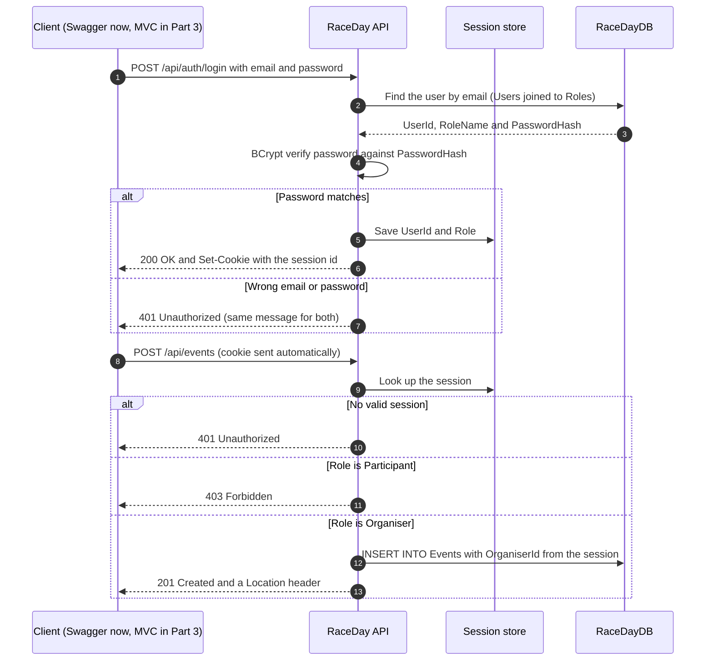
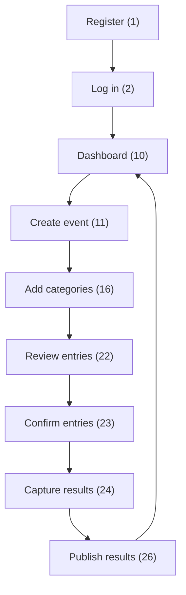
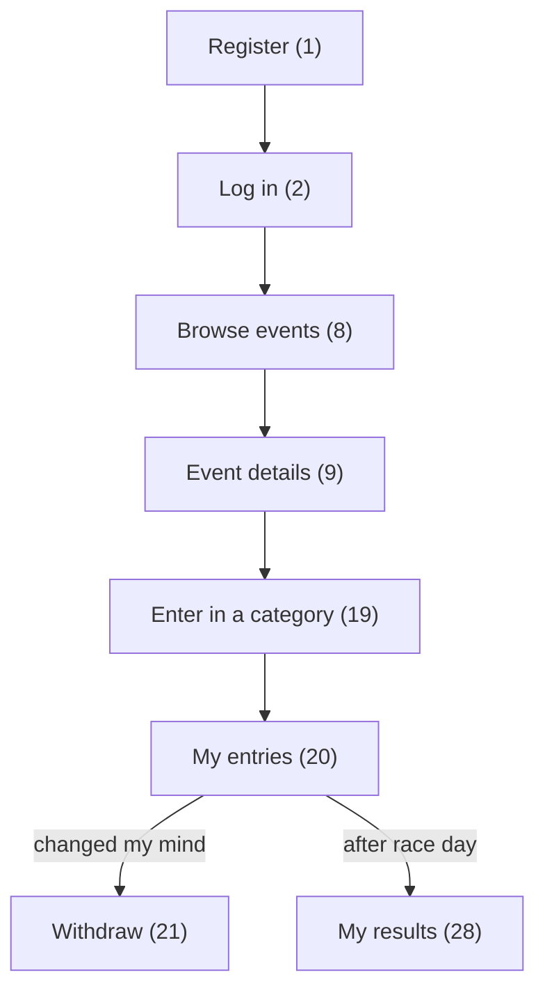

# RaceDay - API Endpoint Plan

| | |
|---|---|
| **Module** | PROG6212 Programming 2B - POE Part 1, Section B |
| **Student** | Ryan Naidoo (ST10487315) |
| **Status** | Written before any API code. Part 2 is built to this plan; any change will be explained in the README. |

This plan lists every endpoint the RaceDay REST API will expose: **28 endpoints** covering Authentication, User Profile, Events, Categories, Event Enrolments and Results. It is based on the Part 2 functional requirements, plus the two image-upload endpoints Part 3 needs (#6 and #14), which are planned now so the API design does not have to change later. Part 2 therefore implements 26 endpoints and Part 3 adds the two uploads.

## Contents

1. [Conventions](#1-conventions) and [how a session works](#11-how-a-session-works)
2. [Endpoints](#2-endpoints) - the six-column plan
3. [Role access matrix](#3-role-access-matrix)
4. [Request field rules](#4-request-field-rules)
5. [Example requests and responses](#5-example-requests-and-responses)
6. [User journeys](#6-user-journeys)
7. [Enrolment status lifecycle](#7-enrolment-status-lifecycle)
8. [Endpoint to table traceability](#8-endpoint-to-table-traceability)
9. [Business rules behind the failure codes](#9-business-rules-behind-the-failure-codes)
10. [Requirement coverage](#10-requirement-coverage)
11. [Out of scope](#11-out-of-scope)

## 1. Conventions

| Topic | Convention |
|---|---|
| Routes | Every route starts with `/api/` and uses plural nouns (`/api/events`, `/api/categories`). `{id}` values are whole numbers. |
| Data | JSON with camelCase names. Dates use ISO 8601 (`2027-03-14T06:30:00`); finish times use `hh:mm:ss`. A `?` after a field name means it is optional. |
| Sessions | `POST /api/auth/login` creates a server-side session that stores the user's **UserId** and **Role**. The API returns a session cookie, which the client (Swagger UI now, the MVC app in Part 3) sends with every request. `POST /api/auth/logout` destroys the session. |
| Role Required | **None** = public. **Any** = any logged-in user. **Organiser** or **Participant** = that role only. **(owner)** = the Organiser must also be the one who created the event. **(own)** = a Participant can only act on their own entry. |
| Success codes | `200 OK`, `201 Created` (with a `Location` header), `204 No Content`. |
| Failure codes | `400 Bad Request` (validation failed), `401 Unauthorized` (no valid session), `403 Forbidden` (wrong role or not the owner), `404 Not Found` (ID does not exist), `409 Conflict` (breaks a business rule, e.g. a duplicate). Meanings follow HTTP Semantics (Fielding, Nottingham and Reschke, 2022). |
| Error body | ProblemDetails JSON `{ type, title, status, detail }` (Nottingham, Wilde and Dalal, 2023), ASP.NET Core's standard error format - never a raw exception. |
| Public access | Only register and login are public. Every other endpoint needs a valid session. |

### 1.1 How a session works

Login checks the password against the BCrypt hash, then saves the user's ID and role in a server-side session. Every later request carries the session cookie, and the API checks it **before** doing anything: no session gives 401, the wrong role gives 403.



The organiser's ID always comes from the session, never from the request body, so nobody can create or edit an event in someone else's name.

## 2. Endpoints

### 2.1 Authentication

| # | HTTP Method | Route | Description | Role Required | Request Body | Expected Response |
|---|---|---|---|---|---|---|
| 1 | POST | `/api/auth/register` | Creates an account. The user chooses Organiser or Participant, and the password is hashed with BCrypt before it is stored. | None | `{ firstName, lastName, email, password, role, phoneNumber?, dateOfBirth? }` | **201 Created** - new profile (never the password hash)<br>**400 Bad Request** - missing or invalid field, weak password, role not Organiser/Participant, Participant without a date of birth<br>**409 Conflict** - email already registered |
| 2 | POST | `/api/auth/login` | Checks the password against the stored hash and starts a session holding the user's ID and role. | None | `{ email, password }` | **200 OK** - `{ userId, fullName, email, role }` plus the session cookie<br>**400 Bad Request** - email or password missing<br>**401 Unauthorized** - wrong email or password (same message for both, so emails can't be guessed) |
| 3 | POST | `/api/auth/logout` | Ends the current session so the cookie stops working. | Any | None | **204 No Content** - logged out<br>**401 Unauthorized** - no active session |

### 2.2 User Profile

| # | HTTP Method | Route | Description | Role Required | Request Body | Expected Response |
|---|---|---|---|---|---|---|
| 4 | GET | `/api/users/me` | Returns the logged-in user's own profile (the profile page for both roles). | Any | None | **200 OK** - `{ userId, firstName, lastName, email, role, phoneNumber, dateOfBirth, profilePictureUrl, createdAt }`<br>**401 Unauthorized** |
| 5 | PUT | `/api/users/me` | Updates the logged-in user's own details. Email and role can't be changed here, so a Participant can never make themselves an Organiser. | Any | `{ firstName, lastName, phoneNumber?, dateOfBirth? }` | **200 OK** - updated profile<br>**400 Bad Request** - invalid field (e.g. date of birth in the future)<br>**401 Unauthorized** |
| 6 | POST | `/api/users/me/profile-picture` | Uploads a profile picture to Azure Blob Storage and saves its URL on the user. *Built in Part 3.* | Any | `multipart/form-data`: `file` (JPG or PNG, max 2 MB) | **200 OK** - `{ profilePictureUrl }`<br>**400 Bad Request** - no file, wrong type or too big<br>**401 Unauthorized** |

### 2.3 Events

| # | HTTP Method | Route | Description | Role Required | Request Body | Expected Response |
|---|---|---|---|---|---|---|
| 7 | GET | `/api/event-types` | Lists the event types (Run, Walk, Cycle) for dropdowns and filters. | Any | None | **200 OK** - `[ { eventTypeId, typeName } ]`<br>**401 Unauthorized** |
| 8 | GET | `/api/events` | Lists upcoming events, soonest first. Optional filters: `?type=Run&search=soweto&from=2026-10-01&to=2026-12-31&includePast=false`. | Any | None (query string only) | **200 OK** - `[ { eventId, name, eventDate, location, distanceKm, eventType, bannerImageUrl } ]` (empty list if nothing matches)<br>**400 Bad Request** - bad filter (e.g. `from` after `to`, unknown type)<br>**401 Unauthorized** |
| 9 | GET | `/api/events/{id}` | Returns one event in full, with the organiser's name and its categories (including spaces left), so a Participant can choose what to enter. | Any | None | **200 OK** - event details + `organiserName` + `categories[]`<br>**401 Unauthorized**<br>**404 Not Found** - no event with that ID |
| 10 | GET | `/api/events/mine` | Organiser dashboard: the logged-in organiser's events with their dates and total, confirmed and pending enrolments per event. | Organiser | None | **200 OK** - `[ { eventId, name, eventDate, eventType, totalEnrolments, confirmed, pending } ]`<br>**401 Unauthorized**<br>**403 Forbidden** - not an Organiser |
| 11 | POST | `/api/events` | Creates an event owned by the logged-in organiser. | Organiser | `{ name, description, eventDate, location, distanceKm, eventTypeId }` | **201 Created** - new event + `Location` header<br>**400 Bad Request** - missing field, date in the past, distance of 0 or less, unknown eventTypeId<br>**401 Unauthorized**<br>**403 Forbidden** - not an Organiser |
| 12 | PUT | `/api/events/{id}` | Updates an event. Only the organiser who created it may change it. | Organiser (owner) | `{ name, description, eventDate, location, distanceKm, eventTypeId }` | **200 OK** - updated event<br>**400 Bad Request** - validation failed<br>**401 Unauthorized**<br>**403 Forbidden** - not the owner<br>**404 Not Found** |
| 13 | DELETE | `/api/events/{id}` | Deletes an event and its categories. Refused once anyone has entered, so participants' entries and results are never wiped by accident. | Organiser (owner) | None | **204 No Content** - deleted<br>**401 Unauthorized**<br>**403 Forbidden** - not the owner<br>**404 Not Found**<br>**409 Conflict** - event already has enrolments |
| 14 | POST | `/api/events/{id}/banner` | Uploads the event banner image to Azure Blob Storage and saves its URL on the event. *Built in Part 3.* | Organiser (owner) | `multipart/form-data`: `file` (JPG or PNG, max 5 MB) | **200 OK** - `{ bannerImageUrl }`<br>**400 Bad Request** - no file, wrong type or too big<br>**401 Unauthorized**<br>**403 Forbidden** - not the owner<br>**404 Not Found** |

### 2.4 Categories

| # | HTTP Method | Route | Description | Role Required | Request Body | Expected Response |
|---|---|---|---|---|---|---|
| 15 | GET | `/api/events/{eventId}/categories` | Lists an event's categories, with spaces left where there is an entry limit. | Any | None | **200 OK** - `[ { categoryId, name, categoryType, minAge, maxAge, distanceKm, maxParticipants, spacesLeft } ]`<br>**401 Unauthorized**<br>**404 Not Found** - no such event |
| 16 | POST | `/api/events/{eventId}/categories` | Adds an age or distance category (e.g. Under 20, 21km) to one of the organiser's events. | Organiser (owner) | `{ name, categoryType, minAge?, maxAge?, distanceKm?, maxParticipants? }` | **201 Created** - new category<br>**400 Bad Request** - type not Age/Distance, minAge above maxAge, Age category with no age limit, Distance category without distanceKm<br>**401 Unauthorized**<br>**403 Forbidden** - not the owner<br>**404 Not Found** - no such event<br>**409 Conflict** - name already used in this event |
| 17 | PUT | `/api/categories/{id}` | Updates a category on one of the organiser's events. | Organiser (owner) | Same as #16 | **200 OK** - updated category<br>**400 / 401 / 403 / 404 / 409** - same reasons as #16 |
| 18 | DELETE | `/api/categories/{id}` | Removes a category that nobody has entered yet. | Organiser (owner) | None | **204 No Content** - deleted<br>**401 Unauthorized**<br>**403 Forbidden** - not the owner<br>**404 Not Found**<br>**409 Conflict** - participants already entered this category |

### 2.5 Event Enrolments

| # | HTTP Method | Route | Description | Role Required | Request Body | Expected Response |
|---|---|---|---|---|---|---|
| 19 | POST | `/api/events/{eventId}/enrolments` | Enters the logged-in participant into an event in the category they chose. Recorded immediately with status Pending. | Participant | `{ categoryId }` | **201 Created** - `{ enrolmentId, eventId, categoryId, status: "Pending", enrolledAt }`<br>**400 Bad Request** - category not part of this event, event already happened, participant's age on race day outside the category's range<br>**401 Unauthorized**<br>**403 Forbidden** - not a Participant<br>**404 Not Found** - no such event or category<br>**409 Conflict** - already entered this event, or category full |
| 20 | GET | `/api/enrolments/mine` | Lists every event the logged-in participant has entered, with category and status. | Participant | None | **200 OK** - `[ { enrolmentId, eventId, eventName, eventDate, location, categoryName, status, enrolledAt } ]`<br>**401 Unauthorized**<br>**403 Forbidden** - not a Participant |
| 21 | PUT | `/api/enrolments/{id}/cancel` | Lets a participant withdraw their own entry before race day. The row is kept with status Cancelled so the organiser still sees it. | Participant (own) | None | **200 OK** - enrolment with status Cancelled<br>**400 Bad Request** - event already happened, or entry already cancelled<br>**401 Unauthorized**<br>**403 Forbidden** - not your entry<br>**404 Not Found** |
| 22 | GET | `/api/events/{eventId}/enrolments` | Lists everyone entered in one of the organiser's events, with their category and status. Optional filter `?status=Pending`. | Organiser (owner) | None | **200 OK** - `[ { enrolmentId, participantName, email, categoryName, status, enrolledAt, hasResult } ]`<br>**401 Unauthorized**<br>**403 Forbidden** - not the owner<br>**404 Not Found** |
| 23 | PUT | `/api/enrolments/{id}/status` | Lets the organiser confirm (or change) the status of an entry in their event. | Organiser (owner) | `{ status }` - Pending, Confirmed or Cancelled | **200 OK** - updated enrolment<br>**400 Bad Request** - invalid status value<br>**401 Unauthorized**<br>**403 Forbidden** - not the owner<br>**404 Not Found** |

### 2.6 Results

| # | HTTP Method | Route | Description | Role Required | Request Body | Expected Response |
|---|---|---|---|---|---|---|
| 24 | POST | `/api/events/{eventId}/results` | Captures a participant's finish time and position after the event. Saved as unpublished until the organiser publishes. | Organiser (owner) | `{ enrolmentId, finishTime, finishPosition }` e.g. `"01:21:37"`, `47` | **201 Created** - new result<br>**400 Bad Request** - event hasn't happened yet, entry not in this event or not Confirmed, invalid time or position<br>**401 Unauthorized**<br>**403 Forbidden** - not the owner<br>**404 Not Found** - no such event or enrolment<br>**409 Conflict** - result already captured for this entry, or position already taken |
| 25 | PUT | `/api/results/{id}` | Corrects a captured finish time or position. | Organiser (owner) | `{ finishTime, finishPosition }` | **200 OK** - updated result<br>**400 Bad Request** - invalid time or position<br>**401 Unauthorized**<br>**403 Forbidden** - not the owner<br>**404 Not Found**<br>**409 Conflict** - position already taken |
| 26 | PUT | `/api/events/{eventId}/results/publish` | Publishes all captured results for the event so participants can see them. | Organiser (owner) | None | **200 OK** - `{ publishedCount }`<br>**400 Bad Request** - no results captured yet<br>**401 Unauthorized**<br>**403 Forbidden** - not the owner<br>**404 Not Found** |
| 27 | GET | `/api/events/{eventId}/results` | Full results for one of the organiser's events (published and unpublished), ordered by position - used on the results entry page. | Organiser (owner) | None | **200 OK** - `[ { resultId, finishPosition, participantName, categoryName, finishTime, isPublished } ]`<br>**401 Unauthorized**<br>**403 Forbidden** - not the owner<br>**404 Not Found** |
| 28 | GET | `/api/results/mine` | The participant's race history: published results only, with position out of total finishers (e.g. 47th of 312). | Participant | None | **200 OK** - `[ { eventName, eventDate, categoryName, finishTime, finishPosition, totalFinishers } ]`<br>**401 Unauthorized**<br>**403 Forbidden** - not a Participant |

## 3. Role access matrix

Who can call each endpoint. **owner** = only on events they created; **own** = only their own entry. Every "No" is refused with 401 (not logged in) or 403 (logged in with the wrong role).

| # | Endpoint | Public | Organiser | Participant |
|---|---|---|---|---|
| 1 | `POST /api/auth/register` | Yes | Yes | Yes |
| 2 | `POST /api/auth/login` | Yes | Yes | Yes |
| 3 | `POST /api/auth/logout` | No | Yes | Yes |
| 4 | `GET /api/users/me` | No | Yes | Yes |
| 5 | `PUT /api/users/me` | No | Yes | Yes |
| 6 | `POST /api/users/me/profile-picture` | No | Yes | Yes |
| 7 | `GET /api/event-types` | No | Yes | Yes |
| 8 | `GET /api/events` | No | Yes | Yes |
| 9 | `GET /api/events/{id}` | No | Yes | Yes |
| 10 | `GET /api/events/mine` | No | Yes | No |
| 11 | `POST /api/events` | No | Yes | No |
| 12 | `PUT /api/events/{id}` | No | owner | No |
| 13 | `DELETE /api/events/{id}` | No | owner | No |
| 14 | `POST /api/events/{id}/banner` | No | owner | No |
| 15 | `GET /api/events/{eventId}/categories` | No | Yes | Yes |
| 16 | `POST /api/events/{eventId}/categories` | No | owner | No |
| 17 | `PUT /api/categories/{id}` | No | owner | No |
| 18 | `DELETE /api/categories/{id}` | No | owner | No |
| 19 | `POST /api/events/{eventId}/enrolments` | No | No | Yes |
| 20 | `GET /api/enrolments/mine` | No | No | Yes |
| 21 | `PUT /api/enrolments/{id}/cancel` | No | No | own |
| 22 | `GET /api/events/{eventId}/enrolments` | No | owner | No |
| 23 | `PUT /api/enrolments/{id}/status` | No | owner | No |
| 24 | `POST /api/events/{eventId}/results` | No | owner | No |
| 25 | `PUT /api/results/{id}` | No | owner | No |
| 26 | `PUT /api/events/{eventId}/results/publish` | No | owner | No |
| 27 | `GET /api/events/{eventId}/results` | No | owner | No |
| 28 | `GET /api/results/mine` | No | No | Yes |

**Totals:** 2 public, 8 for any logged-in user, 14 Organiser-only (12 of them owner-only) and 4 Participant-only.

## 4. Request field rules

The API validates every request body with these rules (data annotations in Part 2) and returns **400 Bad Request** with the failing field names when one is broken. The limits match the database columns, and the last column links each rule to the database, so bad data is stopped twice.

**Register (#1) and update profile (#5).** Update profile accepts only firstName, lastName, phoneNumber and dateOfBirth.

| Field | Type | Required | Rules | Database |
|---|---|---|---|---|
| firstName | string | Yes | 1-50 characters | `Users.FirstName` NVARCHAR(50) |
| lastName | string | Yes | 1-50 characters | `Users.LastName` NVARCHAR(50) |
| email | string | Yes (#1 only) | Valid email, max 256 characters, not already registered (case ignored) | `UQ_Users_Email`, `CK_Users_Email` |
| password | string | Yes (#1 only) | 8-100 characters with an uppercase letter, a lowercase letter and a digit | Stored only as a BCrypt hash in `Users.PasswordHash` |
| role | string | Yes (#1 only) | `Organiser` or `Participant` | `Users.RoleId` to `Roles`, `CK_Roles_RoleName` |
| phoneNumber | string | No | Max 20 characters | `Users.PhoneNumber` NVARCHAR(20) |
| dateOfBirth | date | Participants only | In the past and after 1900-01-01 | `CK_Users_DateOfBirth` |

**Login (#2):** `email` and `password`, both required.

**Create or update an event (#11, #12)**

| Field | Type | Required | Rules | Database |
|---|---|---|---|---|
| name | string | Yes | 3-150 characters | `Events.Name` NVARCHAR(150) |
| description | string | Yes | 10-2000 characters | `Events.Description` NVARCHAR(2000) |
| eventDate | date-time | Yes | In the future | `Events.EventDate` |
| location | string | Yes | 3-200 characters | `Events.Location` NVARCHAR(200) |
| distanceKm | decimal | Yes | 0.01-9999.99, up to 2 decimals | `CK_Events_DistanceKm`, DECIMAL(6,2) |
| eventTypeId | int | Yes | Must exist (1 Run, 2 Walk, 3 Cycle) | `FK_Events_EventTypes` |

**Create or update a category (#16, #17)**

| Field | Type | Required | Rules | Database |
|---|---|---|---|---|
| name | string | Yes | 1-100 characters, unique within the event | `UQ_Categories_Event_Name` |
| categoryType | string | Yes | `Age` or `Distance` | `CK_Categories_CategoryType` |
| minAge, maxAge | int | Age: at least one | 0-120, and minAge not above maxAge | `CK_Categories_AgeRange`, `CK_Categories_AgeNeedsLimit` |
| distanceKm | decimal | Distance: Yes | 0.01-9999.99 | `CK_Categories_DistanceKm`, `CK_Categories_DistanceNeedsKm` |
| maxParticipants | int | No | 1 or more (leave out for unlimited) | `CK_Categories_MaxParticipants` |

**Enrolments and results (#19, #23, #24, #25)**

| Field | Type | Required | Rules | Database |
|---|---|---|---|---|
| categoryId (#19) | int | Yes | Must belong to the event in the route | `FK_Enrolments_Categories` |
| status (#23) | string | Yes | `Pending`, `Confirmed` or `Cancelled` | `CK_Enrolments_Status` |
| enrolmentId (#24) | int | Yes | A Confirmed entry in this event, with no result yet | `UQ_Results_EnrolmentId` |
| finishTime (#24, #25) | string | Yes | `hh:mm:ss`, from 00:00:01 to 23:59:59 | `CK_Results_FinishTime`, TIME(0) |
| finishPosition (#24, #25) | int | Yes | 1 or more, not already used in this event | `CK_Results_FinishPosition` |

## 5. Example requests and responses

The examples use the seed data from `RaceDay_Database.sql`, so the same values appear in the video demo.

**Register a participant (#1)**

```http
POST /api/auth/register
Content-Type: application/json

{
  "firstName": "Sipho",
  "lastName": "Ndlovu",
  "email": "sipho.ndlovu@example.com",
  "password": "RaceDay@2026",
  "role": "Participant",
  "phoneNumber": "071 555 0103",
  "dateOfBirth": "1994-03-12"
}
```

```json
HTTP/1.1 201 Created
Location: /api/users/me

{
  "userId": 3,
  "firstName": "Sipho",
  "lastName": "Ndlovu",
  "email": "sipho.ndlovu@example.com",
  "role": "Participant",
  "phoneNumber": "071 555 0103",
  "dateOfBirth": "1994-03-12",
  "profilePictureUrl": null,
  "createdAt": "2026-05-20T19:05:00"
}
```

**Log in (#2)** - the response sets the session cookie that every later request sends back.

```json
HTTP/1.1 200 OK
Set-Cookie: .AspNetCore.Session=CfDJ8...; path=/; samesite=lax; httponly

{
  "userId": 3,
  "fullName": "Sipho Ndlovu",
  "email": "sipho.ndlovu@example.com",
  "role": "Participant"
}
```

**Create an event (#11)** - logged in as the organiser Thandi Mokoena.

```http
POST /api/events
Content-Type: application/json

{
  "name": "Soweto Heritage 10K",
  "description": "A 10km road race past Vilakazi Street and other Soweto landmarks, finishing inside Orlando Stadium.",
  "eventDate": "2027-04-25T06:30:00",
  "location": "Orlando Stadium, Soweto",
  "distanceKm": 10.00,
  "eventTypeId": 1
}
```

Response: `201 Created` with `Location: /api/events/4` and the new event in the body.

**Enter an event (#19)** - Sipho enters the Soweto Heritage 10K in the Senior category.

```http
POST /api/events/4/enrolments
Content-Type: application/json

{ "categoryId": 11 }
```

```json
HTTP/1.1 201 Created
Location: /api/enrolments/mine

{
  "enrolmentId": 9,
  "eventId": 4,
  "categoryId": 11,
  "status": "Pending",
  "enrolledAt": "2026-09-20T20:15:00"
}
```

If Sipho sends the same request again, the plan's 409 applies:

```json
HTTP/1.1 409 Conflict
Content-Type: application/problem+json

{
  "type": "https://tools.ietf.org/html/rfc9110#section-15.5.10",
  "title": "Conflict",
  "status": 409,
  "detail": "You have already entered Soweto Heritage 10K."
}
```

**My results (#28)** - "position out of total finishers" is calculated when the request runs.

```json
HTTP/1.1 200 OK

[
  {
    "eventName": "Jozi Sunrise Half Marathon",
    "eventDate": "2026-08-23T06:00:00",
    "categoryName": "Senior (20-39)",
    "finishTime": "01:21:37",
    "finishPosition": 1,
    "totalFinishers": 5
  }
]
```

## 6. User journeys

Each journey is a path through the endpoints above, so every screen in Part 3 already has an endpoint behind it. Numbers in brackets are endpoint numbers.

**Organiser**



**Participant**



