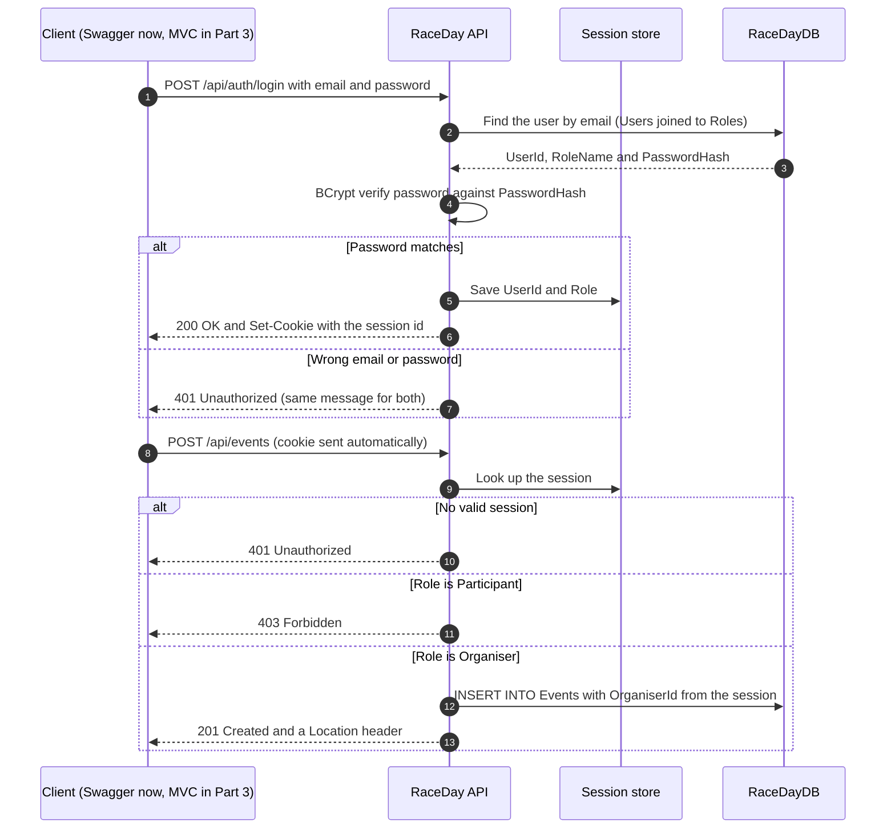

# RaceDay - API Endpoint Plan

| | |
|---|---|
| **Module** | PROG6212 Programming 2B - POE Part 1, Section B |
| **Student** | Ryan Naidoo (ST10487315) |
| **Status** | Written before any API code. Part 2 is built to this plan; any change will be explained in the README. |

This plan lists every endpoint the RaceDay REST API will expose: **28 endpoints** covering Authentication, User Profile, Events, Categories, Event Enrolments and Results. It is based on the Part 2 functional requirements, plus the two image-upload endpoints Part 3 needs (#6 and #14), which are planned now so the API design does not have to change later. Part 2 therefore implements 26 endpoints and Part 3 adds the two uploads.

## Contents

1. [Conventions](#1-conventions) and [how a session works](#11-how-a-session-works)
2. [Endpoints](#2-endpoints) - the six-column plan
3. [Role access matrix](#3-role-access-matrix)
4. [Request field rules](#4-request-field-rules)
5. [Example requests and responses](#5-example-requests-and-responses)
6. [User journeys](#6-user-journeys)
7. [Enrolment status lifecycle](#7-enrolment-status-lifecycle)
8. [Endpoint to table traceability](#8-endpoint-to-table-traceability)
9. [Business rules behind the failure codes](#9-business-rules-behind-the-failure-codes)
10. [Requirement coverage](#10-requirement-coverage)
11. [Out of scope](#11-out-of-scope)

## 1. Conventions

| Topic | Convention |
|---|---|
| Routes | Every route starts with `/api/` and uses plural nouns (`/api/events`, `/api/categories`). `{id}` values are whole numbers. |
| Data | JSON with camelCase names. Dates use ISO 8601 (`2027-03-14T06:30:00`); finish times use `hh:mm:ss`. A `?` after a field name means it is optional. |
| Sessions | `POST /api/auth/login` creates a server-side session that stores the user's **UserId** and **Role**. The API returns a session cookie, which the client (Swagger UI now, the MVC app in Part 3) sends with every request. `POST /api/auth/logout` destroys the session. |
| Role Required | **None** = public. **Any** = any logged-in user. **Organiser** or **Participant** = that role only. **(owner)** = the Organiser must also be the one who created the event. **(own)** = a Participant can only act on their own entry. |
| Success codes | `200 OK`, `201 Created` (with a `Location` header), `204 No Content`. |
| Failure codes | `400 Bad Request` (validation failed), `401 Unauthorized` (no valid session), `403 Forbidden` (wrong role or not the owner), `404 Not Found` (ID does not exist), `409 Conflict` (breaks a business rule, e.g. a duplicate). Meanings follow HTTP Semantics (Fielding, Nottingham and Reschke, 2022). |
| Error body | ProblemDetails JSON `{ type, title, status, detail }` (Nottingham, Wilde and Dalal, 2023), ASP.NET Core's standard error format - never a raw exception. |
| Public access | Only register and login are public. Every other endpoint needs a valid session. |

### 1.1 How a session works

Login checks the password against the BCrypt hash, then saves the user's ID and role in a server-side session. Every later request carries the session cookie, and the API checks it **before** doing anything: no session gives 401, the wrong role gives 403.

The organiser's ID always comes from the session, never from the request body, so nobody can create or edit an event in someone else's name.

